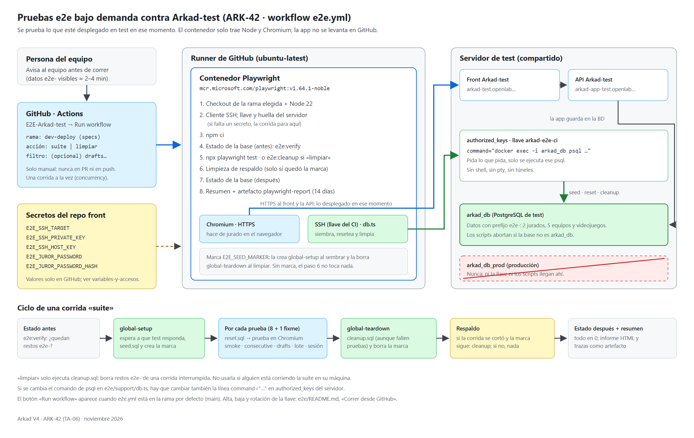
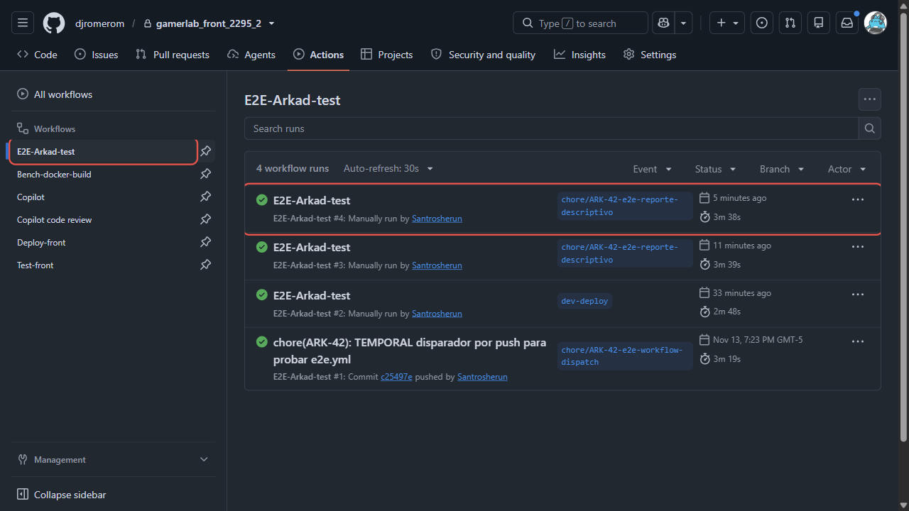
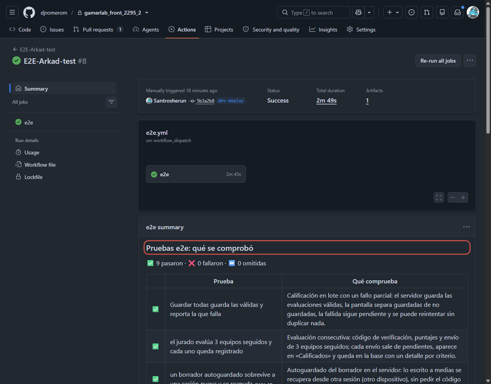
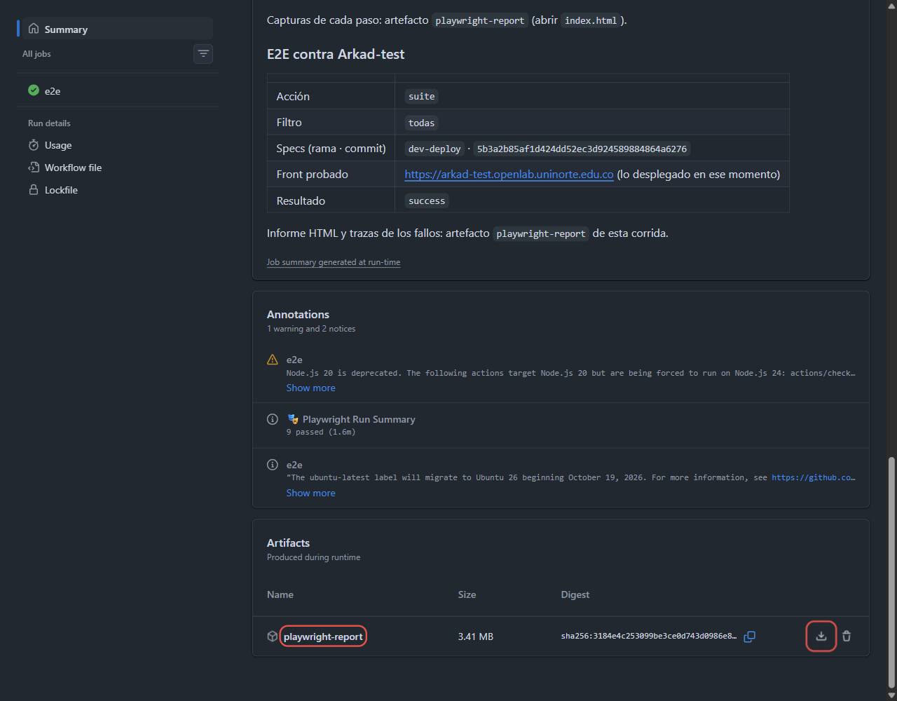
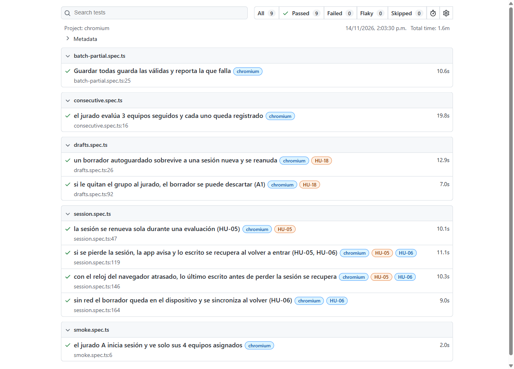
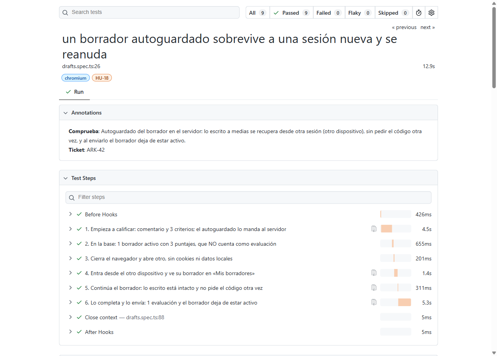
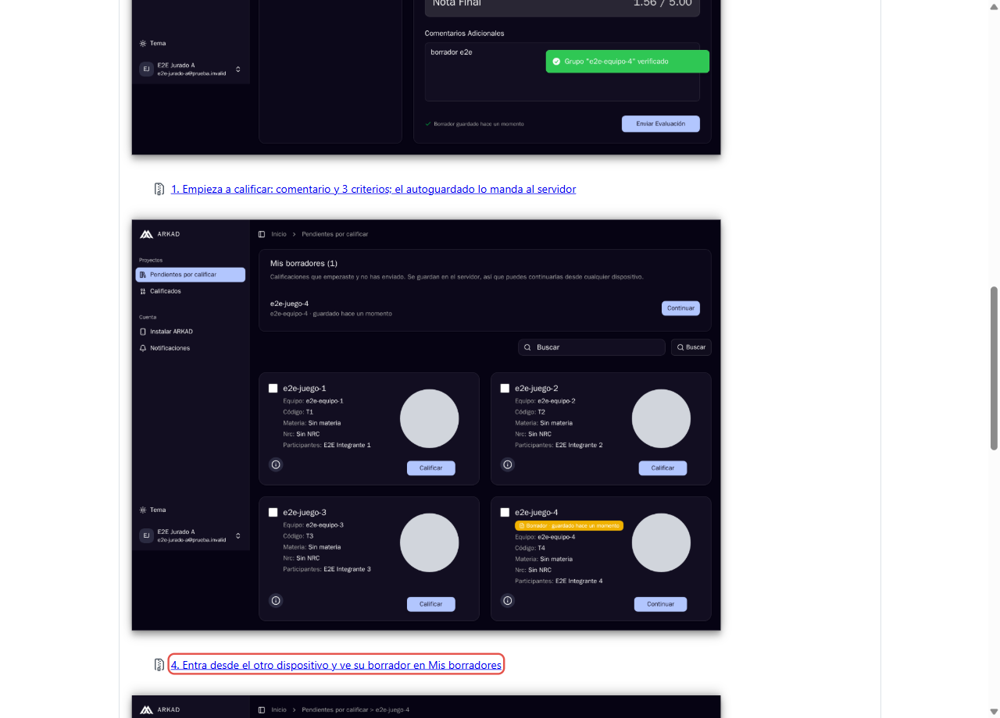

# Pruebas funcionales del flujo de evaluación (ARK-42 / TA-06)

Suite de Playwright que recorre en un navegador real el flujo de calificación del jurado **contra Arkad-test**
(front y API desplegados). Antes de correr siembra sus propios jurados y equipos en la base de test y al terminar
los borra con SQL. No se ejecuta en el CI de los PR.

> **Solo Arkad-test.** Los scripts se niegan a correr si la base no es `arkad_db`. Producción (`arkad_db_prod`)
> nunca se toca. Los datos de las pruebas llevan siempre el prefijo `e2e-`.

## Qué cubre

| Archivo | Caso |
|---|---|
| `smoke.spec.ts` | El jurado A inicia sesión y ve solo sus 4 equipos asignados. |
| `consecutive.spec.ts` | Evaluar 3 equipos seguidos (código de verificación, puntajes, envío). |
| `drafts.spec.ts` | HU-18: el borrador autoguardado sobrevive a una sesión nueva y se reanuda; descartar cuando le quitan el grupo (A1). |
| `batch-partial.spec.ts` | Guardado en bloque con un fallo parcial: se guardan las válidas y se reporta la que falla. |
| `session.spec.ts` | HU-05/06: renovación automática de la sesión, pérdida de sesión con recuperación de lo escrito (también con el reloj del navegador atrasado), y autoguardado sin red. |

La prueba del reloj atrasado de `session.spec.ts` fue un `test.fixme` hasta que se corrigió el defecto que encontró
(la recuperación comparaba la hora del navegador con la del servidor); ahora queda como prueba de regresión. Si una
prueba documenta un defecto aún sin corregir, se marca con `test.fixme` y `detalles({ defecto })`: el informe y el
resumen explican por qué se omite.

## Requisitos

- Node 22 y `npm ci` en este repo. Navegador: `npx playwright install chromium` (una vez).
- Acceso por SSH al servidor de Arkad-test: la base no publica puerto, el SQL se ejecuta con
  `ssh … docker exec -i arkad_db psql`.
  Si la llave tiene passphrase, cargarla antes en un `ssh-agent`: las pruebas usan `BatchMode` y no pueden pedirla.
- Archivo `e2e/.env.e2e` (ignorado por git) a partir de `e2e/.env.e2e.example`:
  destino SSH, llave opcional (`E2E_SSH_KEY`), contraseña de los jurados de prueba y su hash bcrypt.

## Cómo correrla

```bash
npm run e2e                 # toda la suite (≈ 3,5 min); siembra al empezar y limpia al terminar
npx playwright test drafts  # un solo archivo (también siembra y limpia)
npx playwright show-report  # informe HTML de la última corrida

npm run e2e:seed            # solo sembrar (normalmente no hace falta)
npm run e2e:verify          # contar lo que queda con prefijo e2e- (todo en 0 = limpio)
npm run e2e:cleanup         # borrar lo e2e- y restaurar la configuración
```

**Antes de correr:** avisar a quien esté probando la edición activa de test. Mientras dura la corrida aparecen
equipos `e2e-` (5 juegos, 2 jurados) en rankings y avance de esa edición, y los envíos de las pruebas son
evaluaciones reales hasta que se borran.

## Cómo funciona

1. `global-setup.ts` espera a que front y API respondan (Arkad-test devuelve 502 mientras se redespliega tras un
   merge a `dev` / `dev-deploy`) y ejecuta `sql/seed.sql`: 2 jurados, 5 dueños de equipo, 5 equipos con su
   videojuego e integrante, y las asignaciones (equipos 1–4 al jurado A, el 5 al jurado B).
2. Antes de **cada** prueba, `support/test.ts` ejecuta `sql/reset.sql`: deja a los jurados como recién sembrados
   (sin evaluaciones, borradores ni verificaciones, con las asignaciones repuestas). Así las pruebas no dependen
   del orden ni del estado que dejó la anterior.
3. `global-teardown.ts` ejecuta `sql/cleanup.sql`, que borra todo lo `e2e-` en una transacción, imprime las
   filas borradas por tabla y restaura `evaluaciones_abiertas` si el seed la había cambiado. Corre aunque
   fallen pruebas.

Guardas: seed, reset y cleanup abortan si la base no es `arkad_db`; el seed aborta si ya hay datos `e2e-`
(otra corrida en curso o restos); el cleanup se niega a borrar si hay más de 7 usuarios o 5 equipos `e2e-`.

## Si una corrida se interrumpe

Si se mata el proceso (Ctrl+C duro, caída de red o del equipo) pueden quedar datos `e2e-`, y el siguiente
`npm run e2e` abortará en el seed con un mensaje que lo dice. Limpiar a mano y repetir:

```bash
npm run e2e:cleanup   # idempotente: se puede ejecutar varias veces
npm run e2e:verify    # debe salir todo en 0 y e2e_estado_existe = f
```

Si Arkad-test se estaba redesplegando, la suite espera hasta 180 s antes de fallar.

## Correr desde GitHub (bajo demanda)

Workflow `.github/workflows/e2e.yml` (**E2E-Arkad-test**). Prueba **lo que esté desplegado en Arkad-test en ese
momento** con las specs de la rama que se elija. No corre en PR ni en push.



Fuente del esquema: `docs/esquema-e2e.html` (SVG). Para regenerar el PNG, abrirlo con Playwright y hacer
captura del `<svg>` a 1600×1010 con `deviceScaleFactor: 1.5`.

1. GitHub → *Actions* → **E2E-Arkad-test** → *Run workflow*. Elegir la rama de las specs (normalmente
   `dev-deploy`) y la acción:
   - `suite`: corre las pruebas (filtro opcional, por ejemplo `drafts`). ≈ 3–4 min con la preparación.
   - `limpiar`: solo borra restos `e2e-` de una corrida interrumpida. **No usarla si alguien está corriendo la
     suite en su máquina**: le borraría los datos a mitad.
2. Resultado: resumen de la corrida con qué se comprobó, prueba por prueba y paso por paso, y en *Artifacts*,
   `playwright-report` con el informe HTML, las capturas de cada paso y las trazas de los fallos (14 días). Ver
   [Leer el resultado de una corrida](#leer-el-resultado-de-una-corrida).

Desde la terminal, lo mismo (`--ref` es la rama de las specs):

```bash
gh workflow run e2e.yml -R djromerom/gamerlab_front_2295_2 --ref dev-deploy -f accion=suite   # filtro: -f filtro=drafts
gh run watch -R djromerom/gamerlab_front_2295_2                                           # seguirla
gh run download <id-de-la-corrida> -R djromerom/gamerlab_front_2295_2 -n playwright-report -D informe-e2e
npx playwright show-report informe-e2e                                                     # abrirlo
```

GitHub solo muestra *Run workflow* cuando el archivo ya está en la rama por defecto (`main`): el botón aparece
después de la primera promoción que lo incluya.

Qué hace: contenedor `mcr.microsoft.com/playwright` (misma versión que `@playwright/test`; al subir una, subir la
otra), `npm ci`, estado de la base, `npx playwright test`, limpieza de respaldo y estado final. Una sola corrida a
la vez (`concurrency`). La limpieza de respaldo solo borra si **esta** corrida sembró (marca `E2E_SEED_MARKER`),
así nunca toca los datos de otra corrida en curso.

### Leer el resultado de una corrida

**1. Abrir la corrida.** *Actions* → **E2E-Arkad-test** (columna izquierda) → la corrida, la más reciente arriba.



**2. Leer el resumen.** La página de la corrida (*Summary*) trae la tabla **Pruebas e2e: qué se comprobó**: cada
prueba con ✅ / ❌ / ⏭️, sus historias de usuario y qué comportamiento comprueba. Debajo, **Detalle por paso**:
cada prueba desplegable con sus pasos; las que fallan salen abiertas, con el paso que falló y el error. Una prueba
omitida (`test.fixme`) explica por qué (defecto conocido). Para saber qué pasó y qué no, normalmente basta con esto.



**3. Descargar el informe con capturas.** Al final de la misma página, en *Artifacts*, el botón de descarga de
`playwright-report` baja un `.zip` (≈ 3 MB). Hace falta tener sesión en GitHub con acceso al repo.



**4. Abrirlo.** Descomprimir el zip y, desde la raíz de este repo (con `npm ci` hecho), servirlo; se abre en el
navegador en `http://localhost:9323`:

```bash
npx playwright show-report <carpeta-descomprimida>
```

**5. Leer el informe.** La portada lista las pruebas por archivo, con su resultado, duración y etiquetas de
historia de usuario (`HU-05`, `HU-18`…).



Dentro de una prueba: *Annotations* dice qué comprueba y su ticket; *Test Steps* lista los pasos con nombre, cada
uno con su ✓ / ✗ y duración (al desplegarlo se ven las acciones de Playwright que lo componen). El ícono de clip
marca los pasos que tienen captura.



Más abajo, *Screenshots* muestra la captura de la pantalla al terminar cada paso, con el nombre del paso debajo.
Si una prueba falla, el paso que falló también deja su captura, más la captura final y la traza (*Trace*), que
permite recorrer cada acción con su pantalla antes y después.



#### Cómo se arma el informe

- `support/report.ts`: `paso(nombre, fn, page?)` envuelve cada paso en `test.step` y, si recibe `page`, adjunta
  una captura al terminar (pase o falle). `detalles({ comprueba, historias, defecto })` da las anotaciones y
  etiquetas de cada prueba. Una prueba nueva debería usar los dos: así aparece bien en el informe y el resumen.
- `support/summary-reporter.ts`: reporter que, solo en Actions, escribe la tabla y el detalle por paso en el
  resumen de la corrida (`$GITHUB_STEP_SUMMARY`).
- La contraseña de los jurados se escribe sin `fill` (`fillSecret` en `support/session.ts`) para que no quede
  en el título del paso: el informe se publica como artefacto.

### Secretos del repo (Settings → Secrets and variables → Actions)

| Secreto | Qué |
|---|---|
| `E2E_SSH_TARGET` | `usuario@host` del servidor de test (sin alias de `~/.ssh/config`, el CI no lo tiene) |
| `E2E_SSH_PRIVATE_KEY` | Llave privada **propia del CI** (sin passphrase), restringida en el servidor (abajo) |
| `E2E_SSH_HOST_KEY` | Línea de `known_hosts` del servidor; ssh rechaza cualquier otra huella |
| `E2E_JUROR_PASSWORD`, `E2E_JUROR_PASSWORD_HASH` | Contraseña de los jurados `e2e-` y su hash bcrypt (como en `.env.e2e`) |

### Llave del CI: alta, restricción y baja

La llave del CI no es la de una persona: se genera solo para esto y en el servidor se limita a **un único comando**,
el de `remoteCommand()` en `support/db.ts`. Aunque se filtrara, solo serviría para `psql` sobre `arkad_db` (test),
sin shell, sin túneles ni acceso a producción.

```bash
ssh-keygen -t ed25519 -N "" -C arkad-e2e-ci -f arkad-e2e-ci       # en una carpeta temporal
```

En el servidor de test, en el `~/.ssh/authorized_keys` del usuario de `E2E_SSH_TARGET`, una línea **completa**:

```
command="docker exec -i arkad_db psql -U arkad_user -d arkad_db -X -q -v ON_ERROR_STOP=1 -f -",no-pty,no-port-forwarding,no-agent-forwarding,no-X11-forwarding <contenido de arkad-e2e-ci.pub>
```

Después: cargar `arkad-e2e-ci` (privada) como `E2E_SSH_PRIVATE_KEY` y **borrar las dos copias locales**.
Si se cambia el comando de `remoteCommand()`, hay que cambiar también esta línea. Baja o rotación: borrar la línea
del servidor (y, para rotar, repetir el alta con una llave nueva).

## Límites

- Una sola corrida a la vez (comparten jurados y equipos); 1 worker.
- El login de Microsoft queda fuera: los jurados de prueba entran con correo y contraseña.
- Corre contra datos compartidos de test. Si alguien mergea durante la corrida, el despliegue puede cortar una
  prueba a mitad: repetir.
